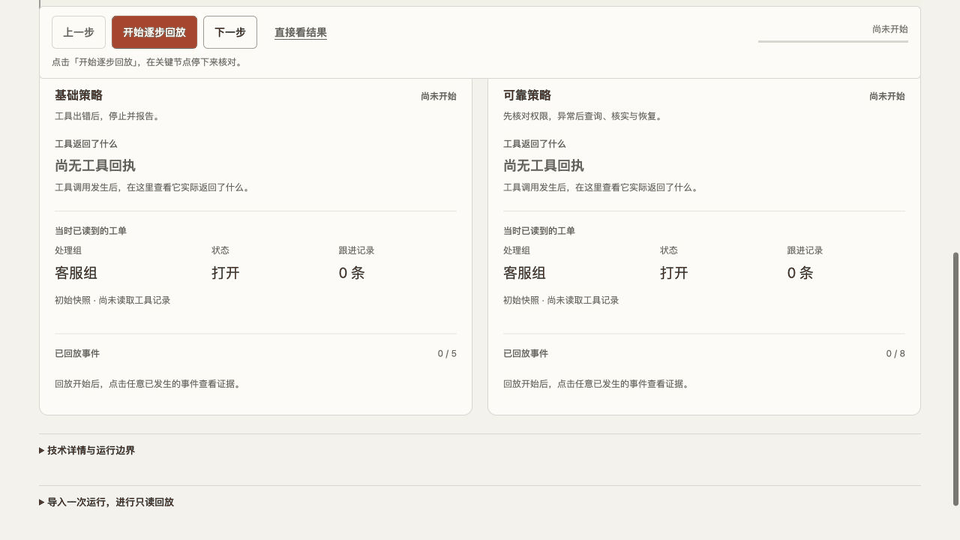

# Agent Execution Bench

[中文](README.md) · [Live example](https://andyzhang666666.github.io/agent-bench/) · [Product scope](docs/PRD.md) · [Test report](docs/TEST-REPORT.md)

A tool response can time out after the database has committed a write. This project evaluates the final ticket state and execution record together, so a fluent completion message cannot stand in for the business effect.

<!-- github-evidence-20261031 -->



[View the static frame](../docs/assets/github/agent-preview.jpg). The animation steps through read-only program records; presentation timing is not execution latency.

[Interaction contract](docs/INTERACTION.md) · [Validation records](docs/TEST-REPORT.md)

## Try the example

Start with the lost-response case. The guided player pauses when the submission receipt is missing. Step backward or forward, resume playback, or jump to the final audit. Compare the baseline and hardened strategies side by side. Both use the same task, initial state, faults, tools and permission checks. The baseline stops after the error; the hardened strategy checks the original operation before continuing. Inspect the final group, open status and note count, then expand the grading evidence or export the record.

Event selection exposes the original receipt and operation ID. Mobile policy tabs share one replay cursor. The final audit separates the Agent’s last known state from the archived database snapshot; safe refusal can meet the case expectation without completing a write. Download a readable Markdown recap or the unchanged original JSON. See the [guided replay change record](docs/GUIDED-REPLAY.md).

The public site replays original deterministic program executions. It does not call a model or write a new ticket. Ten fictional cases cover permissions, approval, failures and recovery.

## What is implemented

- Three bounded tools: query a ticket, submit a change and inspect an operation.
- A Python API and dedicated SQLite database for actual local program runs.
- Approval tied to concrete parameters and ticket version, server-side permission checks, transactions and idempotent operation IDs.
- Explicit unknown, cancelled and conflict states; cancellation stops later steps without undoing committed effects.
- A grader that checks final state, duplicate effects, permissions and consistency between the reply and database.

## Run locally

From this directory, using Python 3.9 or later:

```sh
python3 backend/server.py --port 8877
```

Open `http://127.0.0.1:8877/agent-bench/` and explicitly select local program testing in the technical details. Runs use isolated fictional tickets; confirm the displayed parameters before a write. The dedicated database defaults to `.local/bench.sqlite3` and is ignored by Git.

## Checks

```sh
python3 -m unittest discover -s tests -p 'test_*.py' -v
python3 backend/cli.py rescore path/to/exported-run.json
node --test tests/replay.test.cjs
```

The first command runs the project tests. The second regrades an existing export without calling a model. `python3 backend/cli.py examples` deliberately reruns program cases and regenerates example records with new timestamps and operation IDs.

## Model and hosting boundary

A configurable local model adapter exists, but no real provider was configured or evaluated for this release. Mock-service adapter tests do not establish provider compatibility. Public replay is not a model-success benchmark. The local service binds to loopback and is not a production workflow platform or publicly hosted API.

See the [Chinese implementation notes](README.md), [interaction contract](docs/INTERACTION.md) and existing records for versioned details. Imported JSON is format-checked, not authenticated by a signature.
