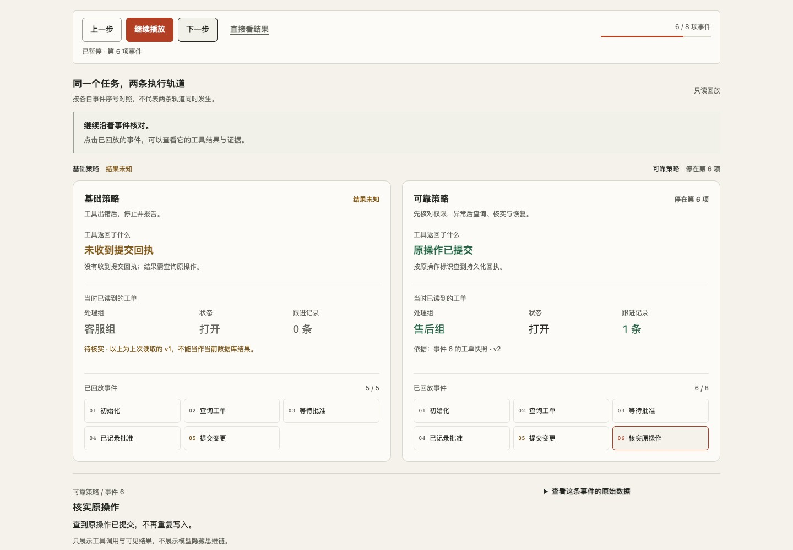
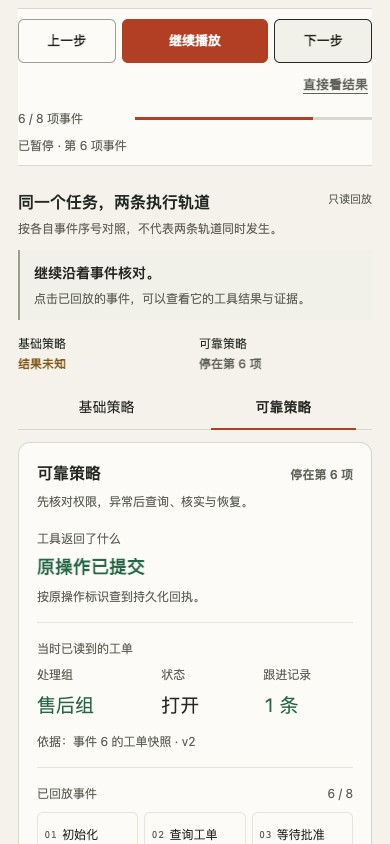

# 逐步回放升级记录

2026-10-30 · P0 / Agent 执行评测台。基于已发布的 `86919e1`，仅改 Agent 应用和它的检查流程。官网首页、另外三个精选项目、原有工单案例与判分没有改动。

## 为什么改

旧版能播放两条策略，但只显示最近三条事件，主要证据藏在完整 JSON 中。超时案例开场还直接说明数据库已经提交，访客难以经历“结果未知—查询原操作—确认实际影响”的判断过程。

这轮把记录组织成可逐步探索的工作区。它仍然是公开的程序案例回放，不调用模型、不重新写入、不冒充在线执行。

## 已完成

| 要求 | 实现与证据 |
|---|---|
| 任务与起点先于结果 | 三个重点入口、全部十个案例；初始说明去掉数据库提交的剧透 |
| 前后步进、播放、暂停和直接看结果 | 同一个只读游标；关键异常自动暂停，操作期间可以中断播放 |
| 当时已知与事后核验分开 | `replay.js` 只投影已访问的查询/回执快照；完整回放后才展示原始最终快照 |
| 三种判断各自可读 | 工具回执、工单数据、是否符合案例预期；未知回执独立颜色，正确拒绝不误写为失败 |
| 两条策略与事件证据 | 记录顺序不变、短轨道停在自身终点；点击事件看代码、版本、原操作标识和 JSON |
| 手机保留回放位置 | 策略标签共用游标，另一条轨道仍有紧凑状态摘要；本地双沙盒审批保持可用 |
| 可读复盘与原记录导出 | 异常事件序号、处理、实际影响、结束声明、逐项判据；Markdown 与原始 JSON 分别导出 |
| 原执行机制保持 | 后端仅增加一个静态资源允许项；权限、审批、去重、取消、恢复和判分未改 |

响应丢失示例中，两条数据库最终都已经写入。基础策略留在结果未知；可靠策略查询原操作后确认完成。界面保持这个真实差异，不制造基础策略没有写入的假失败。

## 视觉与交互

沿用暖纸、墨色、锈色和系统字体，参考 framed-sheet 的浅色工作面。方向记录 seed 为 `598879120`；单一工作区不需要侧栏，保留现有品牌取代通用配色。新标记由两段操作回执与连接线构成；双策略轨道是界面的主要识别元素。

按钮按下、当前事件进入和字段实际变化使用短反馈。减少动态效果时取消动画和平滑滚动，保留关键节点暂停。回放间隔不是实际执行延迟。

实际界面截图，未另绘产品效果：

## 运行证据

- `node --test agent-bench/tests/replay.test.cjs`：4 项通过，覆盖超时不提前取最终数据、回退、新版本查询、十个案例与记录不变。
- `python3 -m unittest discover -s agent-bench/tests -p 'test_*.py' -v`：29 项通过，包括实际 loopback HTTP、SQLite 和本地模型适配桩。没有真实服务商模型调用。
- `tests/browser.py --local`：21 项浏览器检查通过，具体断言见 [结果 JSON](guided-replay-browser-results.json)。覆盖自动暂停、停止播放、步进、最终状态/判据对照、原始导出、导入来源、无写请求、390/768/1280px、键盘、减少动态效果、错误重试、存储受限，以及原有本地审批和恢复流程。
- 离线重算原 timeout-hardened 示例：`passed: true`，判分版本仍为 `state-events-v1`。
- 设计检查器：1440/768/390px，0 FAIL、1 个暖纸配色 warning，按用户保留官网风格的要求保留。代码检查 0 FAIL；等宽文字用于代码和标识，补零数字用于真实事件索引。截图已实际查看。
- [范围核对](guided-replay-scope.json)：相对于本轮起点，Agent 之外原有文件保持不变（仅本项目 CI 例外）；案例、工具/模型执行器、判分和原始记录不变。

“首次访问者一两分钟理解为什么不能直接重试”仍是设计目标，没有冒充用户研究结论。未新增在线后台、模型成绩或生产可靠性声明。旧 TEST-REPORT、SURFACE 和 RELEASE 文档记录首发版本；本文件及当前交互/设计约定记录这次升级。

## 修改记录

- `e8c7932`：只读投影与记录边界测试。
- `961e100`：逐步回放、关键节点、轨道与复盘界面。
- 后续提交：补齐边界验证、说明和实际截图。发布结果另记，不将推送当作部署证据。
