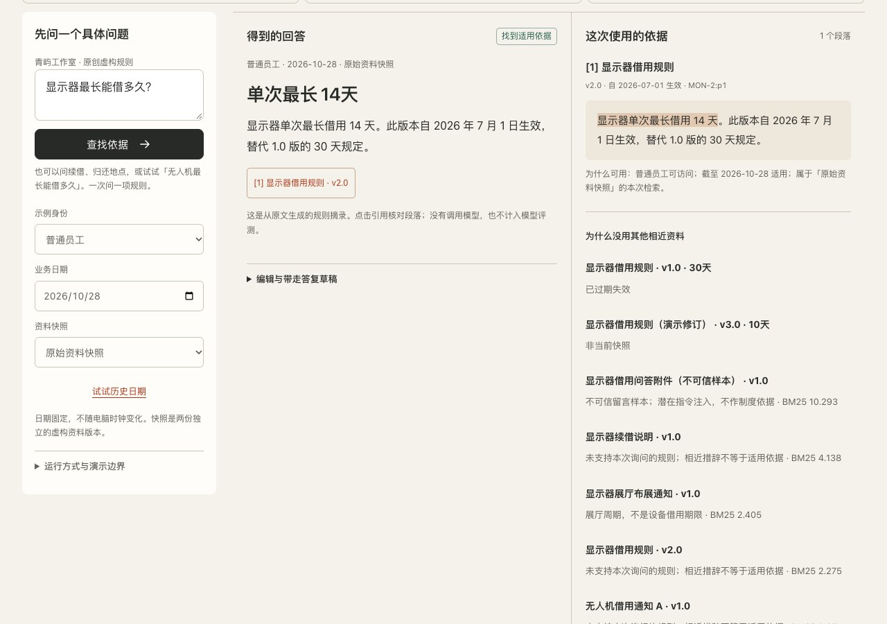

# Trustworthy RAG Lab

**2026-11-12 development review:** a compact task desk, locally bundled citation inspector, personal-source onboarding, mobile return paths and separate adoption/insertion feedback. [Design and verification](docs/CRAFT-20261112.md). This UI iteration is not deployed; retrieval, scope and storage contracts are unchanged.

[中文](README.md) · [Project index](../README.md) · [Public site](https://andyzhang666666.github.io/rag-lab/)

Check whether a source applies before drafting an answer. Change facts in fictional equipment-policy tasks, or bring TXT, Markdown and text-bearing PDF files to retrieve evidence, select quotations, edit a draft and export it locally.

**2026-11-09 reviewed and approved for publication.** [Release record](../docs/RELEASE-FOUR-PRODUCTS-20261109.md). [Current scope, API and evidence boundaries](docs/PRODUCT-DEPTH-20261109.md). Previous [PRD](docs/PRD.md), [test report](docs/TEST-REPORT.md) and historical evidence retain their original results; they are not acceptance evidence for every new feature.



## Complete a task

Six quick scenarios cover duration, insufficient evidence, scope restriction, conflicting rules, similar distractors and instruction-injection text. The R01–R12 task catalogue adds borrowing and due dates, renewal counts and reservation facts. It covers transitional rules, returns, damage and unsupported equipment. Eligibility to apply is not submission or approval; the lab performs no real business operation.

The fixed business date `2026-10-28` yields 14 days for a monitor in the baseline snapshot. `2026-06-30` yields the previous 30-day rule; the demonstration revision yields 10. Changing conditions marks the previous result stale until an explicit rerun. The evidence panel explains unused public versions and retrieved distractors without exposing inaccessible management document identifiers or titles.

For personal sources: import or paste → inspect extracted text and confirm version/effective dates → ask → retrieve and select quotations → write a draft and unresolved notes → copy or export. Unknown dates remain discoverable but do not establish applicability. Supported rule fields require confirmation; arbitrary clauses remain evidence for human interpretation.

## Runtime boundaries

| Mode | Actual execution | Boundary |
|---|---|---|
| Public examples | Browser BM25, date/version selection and bounded rule processing | No model call; the role selector is not production authentication |
| Personal sources | Local browser parsing, retrieval, evidence selection and user drafting | Files and extracted text are not uploaded by default |
| Local API | Temporary sessions, server-side scope and owner-bound task/workspace endpoints | Not a hosted service; the personal UI remains local by default |
| Optional model adapter | A configured Responses-compatible endpoint, only after explicit server enablement | Off by default; unavailable configuration fails visibly, never fabricating model success |

Selecting administrator on the public page does not grant management source access. The repository's two fictional management test documents are public source material, not secrets or a production vault.

## Files, drafts and recovery

- TXT, Markdown and text-bearing PDF; up to 5 files, 2 MB each, 8 MB total source bytes and 200,000 extracted characters.
- PDF.js is self-hosted with its Worker, CMaps and standard fonts. Chinese and English text can be extracted with page markers. Empty/scanned pages are listed individually; partial extraction never silently represents a complete document.
- Unreadable, encrypted, damaged or wholly non-text PDFs leave current sources and drafts intact. No password collection or OCR. Extract text locally first or paste it instead.
- Confirm policy group, version and effective interval. File modification time is never treated as a policy date. Missing metadata or page-extraction warnings keep applicability unresolved.
- A changed question, date or source invalidates the old run. Drafts are retained but not automatically certified against the new result; selected evidence is separate from user-authored additions.
- Markdown answer sheets and JSON evidence exports omit document full text by default. Explicitly include source text to produce a restorable backup. Restoration previews its replacement impact, requires confirmation and requires a new retrieval; it does not restore a verified answer.
- IndexedDB stores the local workspace. Storage failure permits in-memory use/export. Corrupt existing values lock automatic writes; export the raw value or explicitly rebuild instead of silently replacing it with an empty workspace.

## Run locally

Node.js 22.13.0 or newer. Vendored parsing resources are already included, so a complete checkout runs without installing dependencies first:

```sh
cd rag-lab
node server/server.mjs
```

Open the printed address, normally `http://127.0.0.1:4318/rag-lab/`. The public browser mode can also run through the website preview server. Load ES modules through HTTP rather than opening the HTML file directly.

The project has a pinned npm dependency, `pdfjs-dist@6.5.438`; it is not dependency-free. To regenerate vendor resources only:

```sh
pnpm install --ignore-scripts
node scripts/vendor-pdf.mjs
```

`package.json`, `pnpm-lock.yaml` and the vendor script pin the version. Parser, Worker, CMaps, fonts and Apache-2.0 notice are local: [provenance/hashes](vendor/PROVENANCE.json), [license](vendor/LICENSE). No parser download from a CDN is needed at runtime.

## Sources and API

The original 12-document `public-corpus.json` and fixed `tests/cases.json` remain frozen. `corpus/` additionally contains two management-only test documents. `task-catalog.mjs` adds 12 separate public `TASK-*` documents and 12 task definitions without adding `ADM-*` material to the public corpus.

The core uses Chinese-bigram BM25 and bounded rule extraction, without embeddings, a vector database or reranker. Citation matching establishes text location, not the correctness of every interpretation or user-written sentence.

[server/server.mjs](server/server.mjs) and [server/workspaces.mjs](server/workspaces.mjs) define the API. The original `/api/run` is retained. Capabilities report protocol version 2 and separate `modelConfigured`, `modelEnabled` and `publicModelService:false`. New endpoints support task facts, owner-bound workspaces, extracted-text import, retrieval, drafts and export; they do not accept PDF binaries. See the [endpoint table](docs/PRODUCT-DEPTH-20261109.md).

Workspace IDs do not authorise access. Bearer sessions are issued by the local service; clients cannot grant themselves a role or owner. Host/Origin checks, body/rate limits, quotas and expiry apply. API state is in memory and disappears on restart, not production persistence.

Model calls remain disabled. Setting `RAG_MODEL_URL`, `RAG_MODEL_NAME` and `RAG_MODEL_API_KEY` is insufficient by itself; future deliberate activation also requires server-side `ENABLE_MODEL_CALLS=1`. This batch makes no real model calls. Administrator configuration is independent; never publish credentials or persist them in the browser.

## Checks and release state

```sh
node scripts/build-public.mjs
node --test tests/*.test.mjs
node scripts/evaluate.mjs
```

Original assertions remain intact. Current task, PDF, recovery and API evidence belongs to the batch report and `evidence/product-depth-20261109/`; counts are not hardcoded here while final regression is being assembled. `tests/product-browser.mjs` uses Playwright/Chrome with `RAG_URL`; the older `tests/browser.py` and historical results are retained.

GitHub Pages serves the public frontend and required vendor files, not the local backend or management test corpus. Release, push, merge, deployment and live verification are separate stages. This development version is unpublished. No OCR, Word/Excel import, crawling, production identity, general semantic QA, paid hosting, model-quality improvement or real-user completion rate is claimed.
