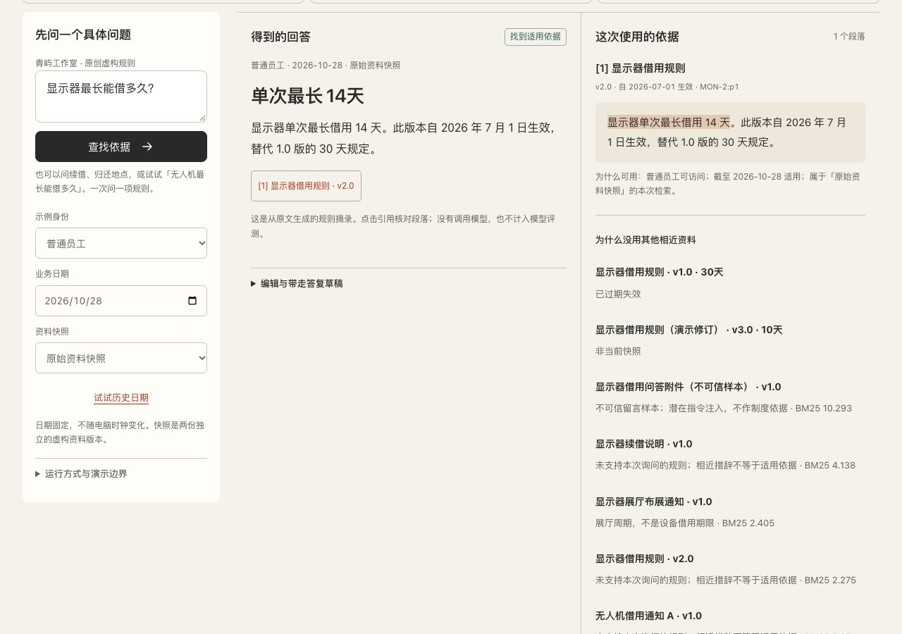

# 可信 RAG 实验台

[English](README.en.md) · [返回项目索引](../README.md) · [公开站](https://andyzhang666666.github.io/rag-lab/)

先判断资料是否适用，再整理一份可以核对的答复。可以改内置任务的日期与事实，也可以带自己的TXT、Markdown或文字版PDF，在本机检索、选择依据、编辑草稿并导出。

**2026-11-09 已通过审阅，获批发布。** [本次发布记录](../docs/RELEASE-FOUR-PRODUCTS-20261109.md)。 [本轮实现、API与证据边界](docs/PRODUCT-DEPTH-20261109.md) · [交互约定](docs/UX-CONTRACT.md)。旧[PRD](docs/PRD.md)、[测试报告](docs/TEST-REPORT.md)及历史证据保留原记录，不代替本轮全部功能验收。

**2026-11-11 开发分支新增：** 个人草稿数字提示、同主题引文范围提醒及同题条件变化说明。已本地验证，尚未合并或部署；[本轮范围、验证与限制](docs/TASK-LOOP-20261111.md)。



## 两条主要任务

**先试一件事。** 六个快捷入口覆盖借用时长、资料不足、权限限制、规则冲突、相似干扰和注入文本。另有R01–R12任务目录，可补领取日期、实际到期日、已续借次数及预约状态，检查续借、过渡条款、归还、损坏及资料未覆盖的情况。提出申请、已经提交、已经批准是不同状态；本站不办理实际业务。

默认日期为 `2026-10-28`，原始快照显示器借期14天；历史日期 `2026-06-30` 为30天，演示修订快照为10天。改条件后保留旧答复并标待重查，可“立即重新查找”。采用来源旁列出当前范围内未采用的旧版本、其他快照及干扰片段，不展示无权访问的管理资料标题或编号。

**使用我的资料。** 导入文件或粘贴文本 → 核对提取原文、版本与生效期间 → 提问 → 检索与选择引文 → 编辑答复和待补事项 → 复制或导出。未知日期可继续检索，但不能宣称资料在本次业务日期适用。受支持规则字段须经用户确认；范围外条款只作为原文依据，不冒充通用语义理解。

## 运行边界

| 方式 | 实际执行 | 边界 |
|---|---|---|
| 公开内置示例 | 浏览器BM25检索、日期／版本筛选及受控规则处理 | 无模型调用；身份下拉不等于生产鉴权 |
| 我的资料 | 浏览器本机解析、检索、引文选择与用户草稿 | 默认不上传原文件或提取文本，未知条款由人判断 |
| 本地API | 临时会话、服务端范围限制、条件任务与会话所属工作区 | 不是在线托管服务；个人页面默认仍在浏览器工作 |
| 可选模型适配器 | 显式配置并由服务端启用后才可能请求Responses兼容端点 | 默认关闭；未配置／未启用明确报错，不伪造模型成功；真实效果待独立验证 |

公开示例选择“设备管理员”也不会得到管理原文。仓库中两份原创管理测试资料只供本机API及检查，是公开的虚构源码材料，并非机密储存方案。生产账号、租户、凭据签发／撤销和托管未在本项目完成。

## 文件、草稿与恢复

- TXT、Markdown、可提取文字的PDF：最多5份、单份2MB、原文件总计8MB、提取文本总计200,000字符。
- PDF使用本地PDF.js解析器、Worker、CMaps及字体，不依赖第三方CDN。支持中英文可提取文本，按页保留定位；逐页未提取文字会列出页号，不能静默视为完整资料。
- 无文字、损坏或加密PDF给出具体反馈；不索取密码、不做OCR。可在本机处理后重新导入或粘贴文本。坏文件不覆盖原资料与草稿。
- 先确认制度组、版本、生效／失效日期，不把文件修改时间当生效日。缺日期、版本或提取缺页时保留适用性缺口。
- 资料、问题或日期变化使旧结果待重查。旧草稿仍保留，重新检索不自动证明它适用；用户补写和单列引文不能混称模型结论。
- Markdown答复单和JSON证据记录默认不附个人文档全文。明确勾选“附来源文本”后，JSON才是可恢复资料和草稿的备份；导入先预览替换影响，确认后替换，恢复后重新检索，不恢复“已验证答案”。
- IndexedDB保存本机工作区；不可用时仍能在当前页面操作、导出。旧值损坏时暂停自动写入，可先下载原始值再明确重建，不用空工作区静默覆盖。

## 本地启动与PDF依赖

需要Node.js **22.13.0或更新版本**。完整源码已包含vendored PDF资源，可直接启动，无需先安装运行依赖：

```sh
cd rag-lab
node server/server.mjs
```

默认 `http://127.0.0.1:4318/rag-lab/`，以终端输出为准。静态模式也可由官网预览服务提供；不要直接双击HTML加载ES modules。

PDF依赖是 `pdfjs-dist@6.5.438`，并非“没有npm依赖”。只在需要重新生成vendor时运行：

```sh
pnpm install --ignore-scripts
node scripts/vendor-pdf.mjs
```

版本由 `package.json`、`pnpm-lock.yaml`和脚本固定。解析器、Worker、CMaps、字体及Apache-2.0许可证位于 `vendor/`；[来源与哈希](vendor/PROVENANCE.json) · [许可证](vendor/LICENSE)。用户浏览器不需要从npm或CDN下载解析器。

## 语料和实现

- `public-corpus.json`：冻结的12份公开原创文档；`corpus/`另外有两份管理测试文档。`scripts/build-public.mjs`继续生成原公开白名单。
- `task-catalog.mjs`：R01–R12任务及另外12份 `TASK-*` 公开补充资料。它们是独立任务扩展，不改旧12文档语料或 `tests/cases.json`，不含 `ADM-*`。
- `engine.mjs`：中文二元词BM25、范围／版本选择、受控规则与引用检查。无embedding、向量库或rerank；具体遗失、续借、归还、清洁意图优先于“多久”等宽泛词。
- `workspace.mjs`、`personal-workbench.mjs`：个人资料、页／段定位、版本确认、用户草稿、备份恢复及存储保护。引用匹配证明文字存在，不证明所有补写或语义推理正确。
- `server/`：本机会话、owner隔离、受限工作区API及可选模型适配器。不是公开在线模型网关。

## API与模型开关

契约以 [server/server.mjs](server/server.mjs) 和 [server/workspaces.mjs](server/workspaces.mjs) 为准，完整接口表见[本轮文档](docs/PRODUCT-DEPTH-20261109.md)。原 `POST /api/run` 保持；新增能力查询、条件任务、会话所属工作区、提取文本导入、运行、草稿和导出。工作区ID不构成授权，客户端不能传 `role`／`owner` 自授权限；不接PDF二进制。

`GET /api/capabilities`返回协议版本2、工作区与任务能力、模型配置／启用状态，`publicModelService`为false。模型默认关闭；只填 `RAG_MODEL_URL`、`RAG_MODEL_NAME`、`RAG_MODEL_API_KEY`不会开启，未来主动启用还需服务端 `ENABLE_MODEL_CALLS=1`。本轮未启用或消费真实模型。

独立管理员凭据配置见 `.env.example`；不放URL、Git或浏览器持久存储。API限本机Host／Origin，有会话、数量、体积和时效限制；服务内存记录重启清空，不是生产持久化或长期消费额度。

## 检查与发布

```sh
node scripts/build-public.mjs
node --test tests/*.test.mjs
node scripts/evaluate.mjs
```

原固定案例与断言继续保留。新任务、个人资料、PDF、恢复与API的具体证据见批次报告及 `evidence/product-depth-20261109/`，不在此硬编码尚在汇总的检查数量。新浏览器脚本为 `tests/product-browser.mjs`，使用Playwright与本机Chrome，`RAG_URL`指定地址；旧 `tests/browser.py`和历史记录原样保留。

GitHub Pages只供给公开前端与必要vendor；后端、原始corpus、本地配置及管理测试原文继续排除。本机API按静态白名单供给资源，不能用暴露整个仓库的普通文件服务冒充权限控制。推送、合并、部署和线上核验分别记录；本开发版尚未公开发布。

未提供OCR、网页爬取、Word／Excel、通用语义问答、真实企业系统、生产鉴权或付费托管；未宣称模型质量、生产准确率或真人任务完成率。
