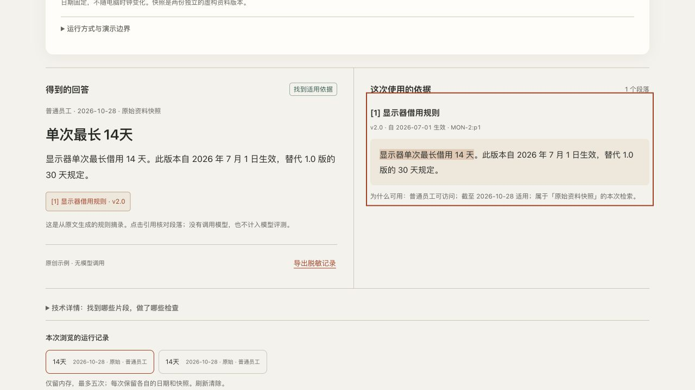

# 可信 RAG 实验台

[English](README.en.md) · [返回项目索引](../README.md)

从虚构的设备规则里找到答案，并解释依据为什么在当前身份、业务日期与资料快照下可用。

[免 Key 体验](https://andyzhang666666.github.io/rag-lab/) · [PRD](docs/PRD.md) · [测试报告](docs/TEST-REPORT.md) · [交互约定](docs/UX-CONTRACT.md)

<!-- github-evidence-20261031 -->



[交互约定](docs/UX-CONTRACT.md) · [验证记录](docs/TEST-REPORT.md)

## 三种运行方式

| 方式 | 实际执行 | 边界 |
|---|---|---|
| 官网默认：原创示例 | 浏览器对 12 份公开虚构文档执行 BM25 检索、日期/版本选择与规则摘录 | 无模型调用、无在线 API，不是历史模型回放；不是权限安全证明。公开包不含管理资料 |
| 本地 API：规则摘录 | API 校验独立会话，先限制角色/快照/日期，再检索实际段落 | 不需模型密钥；管理范围需独立凭据 |
| 本地 API：模型 | 检索后向已配置的 Responses 兼容端点发请求，核对引用和固定关键事实 | 模型配置缺失时明确失败，不伪造回答；本次真实模型联调待验证 |

公开身份下拉框只解释虚构场景。切换到设备管理员不会在官网获得管理原文。源码仓库公开包含两份原创管理测试资料，因此它不是机密储存方案。生产应用需账号、租户、凭据签发/撤销、审计和安全托管；本项目没有实现这些。

## 本地启动

需要 Node.js 22+，无 npm 依赖、无构建步骤。完整 clone 官网仓库后：

```sh
cd rag-lab
node server/server.mjs
```

打开终端打印的 `http://127.0.0.1:4318/rag-lab/`。默认仍为原创示例；展开「运行方式与演示边界」，选择「本地 API · 真实检索 / 规则摘录」。员工会话自动创建，1 小时失效，凭据只留内存。

管理员：在本目录将 `.env.example` 复制为 `.env.local`，自行生成至少 24 字符的随机值写入 `RAG_ADMIN_TOKEN`，再运行 `node --env-file=.env.local server/server.mjs`。下拉选择设备管理员，并在本机页面输入同一凭据。不把此值放入 URL、Git、官网或浏览器持久存储。

模型为可选配置：仅在本项目 `.env.local` 设置 `RAG_MODEL_URL`、`RAG_MODEL_NAME`、`RAG_MODEL_API_KEY`。端点需支持 `/v1/responses` JSON schema 输出协议，URL 使用完整路径；模型名由你实际有权使用的服务确定，没有预设付费模型或自动回退。参考 [OpenAI 官方文本生成文档](https://developers.openai.com/api/docs/guides/text)。不会读取其他工程的环境文件、密钥或 Codex 登录信息。

若配置后生成失败，记录明确标出失败阶段；可以重试或明确切回规则摘录。证据不足、冲突或问题不明确时由程序直接返回状态，不把不适用资料发给模型。

## 数据和实现

- `corpus/`：14 份原创 Markdown，JSON front matter 保存稳定文档编号、制度组、版本、生效区间、角色、快照。两份管理资料只供本地 API 和测试。
- `engine.mjs`：按标题/段落切分；先授权、选快照、按查询日选择当时有效版本，再建立本次 BM25 索引。中文二元词，无 embedding、向量库或 rerank。相同生效日且无优先级的版本保留双方，冲突不任意选取。
- `public-corpus.json`：`node scripts/build-public.mjs` 生成的公开白名单，排除管理文档的标题、编号和正文。不要用普通静态服务器暴露完整仓库来替代本地 API 的文件白名单。
- `server/server.mjs`：Node 标准库 HTTP；本机地址/Origin 限制；临时员工会话与独立管理员凭据；未知参数（包括 `role`）拒绝。
- `server/model.mjs`：真实 HTTP 模型适配器。已授权召回段落作为不可信 JSON 数据；无工具调用。引用必须真实存在且原文匹配，已识别的数值/单位和引用另作检查。自由文本其余语义仍需人工复核；定位正确不等于回答正确。
- `tests/cases.json`：12 个固定问题、角色、日期、快照、参考片段和关键事实。检索与生成分开判分，无装饰性综合分。
- `evidence/`：本次实际执行的离线记录、检查结果与浏览器截图。协议测试的合成输出不计作真实模型记录。

默认业务日期固定为 `2026-10-28`；历史案例是 `2026-06-30`。原始快照当前显示器为 14 天；历史版 30 天；演示修订快照自 10 月 20 日为 10 天。切换条件必须重跑，旧结果保留原日期、资料、段落和版本。

首版只对有限设备与规则词汇检查覆盖（借用时长、续借、归还、遗失、库存、采购、清洁等）。无法识别、缺少设备或多项问题要求澄清；押金/赔偿无依据不推算。改语料或词汇后应更新版本并重跑固定题，不把此规则抽取器称为通用语义理解。

## API 与资源限制

- `POST /api/session`，body `{}`：只创建员工会话；不能指定角色。
- `GET /api/whoami`：独立 Bearer 凭据确认当前服务端角色。
- `POST /api/run`：仅接受 `question`（1–300 字）、`date`、`snapshot`、`generation`（`extractive` / `model`）。
- `GET /api/runs/:id/sources?chunkId=...`：只返回该会话、该运行中实际召回且仍获授权的段落。
- `GET /api/runs/:id/export`：该会话的脱敏记录，包含原问题、条件、实际片段、版本、原始模型输出（若有）和检查结果。凭据不导出。常见邮箱、手机号、Bearer 和 key 格式做尽力脱敏；不要输入真实资料。

请求体 4 KiB；普通会话每分钟 30 次、进程总计每分钟 100 次；模型每会话每分钟 4 次、每次服务进程最多 20 次；模型超时 12 秒、最多 650 输出 token、响应体上限 64 KiB，回答文本上限 1200 字符。默认不落盘，服务内最多保存 100 次运行、一小时过期；页面最多五次历史。失败原始输出只在所属会话的脱敏导出中可见。重启会清空会话和记录，同时重置进程预算，因此不是生产消费限额。

## 复现检查

```sh
node scripts/build-public.mjs
node --test tests/*.test.mjs
node scripts/evaluate.mjs
```

浏览器脚本 `tests/browser.py` 使用 Python Playwright 和本机 Chrome。安装到自己的虚拟环境后，运行两个本地服务：官网静态预览 `python -m http.server 4319 --bind 127.0.0.1`（在仓库根目录），以及使用**测试专用**凭据 `fictional-admin-credential-for-browser-tests` 的 API（端口 4318）。该公开固定值只用于测试，不可用于真实部署。然后 `python rag-lab/tests/browser.py`。可通过 `CHROME_PATH`、`RAG_STATIC_URL`、`RAG_LOCAL_URL` 改地址。当前执行使用已安装 `webapp-testing/scripts/with_server.py` 管理两服务生命周期，未将这台机器的技能绝对路径写成项目运行依赖。

## 发布与协作

源码、后端、资料和测试均在本模块目录；GitHub Pages 只提供公开前端资源。`_config.yml` 排除后端、原始 corpus、测试、运行记录和本地配置；本机 API 同样只允许前端静态白名单。公开 Git 源码本身仍可读，隔离的是运行时供给范围。

官网接入使用本模块的幂等 `scripts/integrate-site.mjs` 增量添加作品记录与单张卡片，不重写整站设计、不运行旧生成器来覆盖并行新增。未来官网内容再生成时，先快照保存旧基线之后新增的项目及其原始卡片（含 Agent Bench），在末尾原样恢复，再调用本项目增量接入函数。接入前 fetch 最新 main，保护其他 Agent 模块；正常 push，不强推。

未做 PDF 上传、OCR、爬取、真实公司系统、生产鉴权、多 Agent、通用后台或付费托管。推送、合并、部署、线上操作分别在交付记录中证明。
