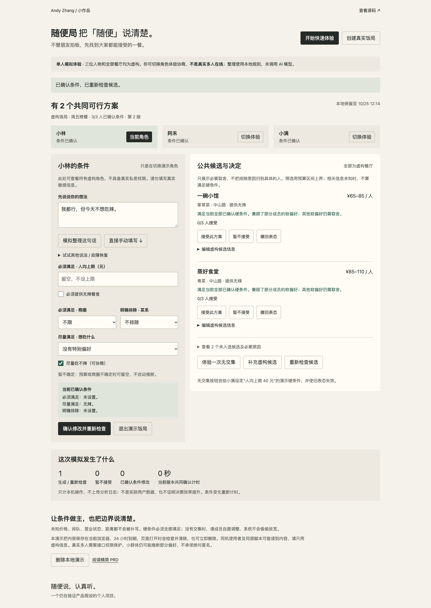
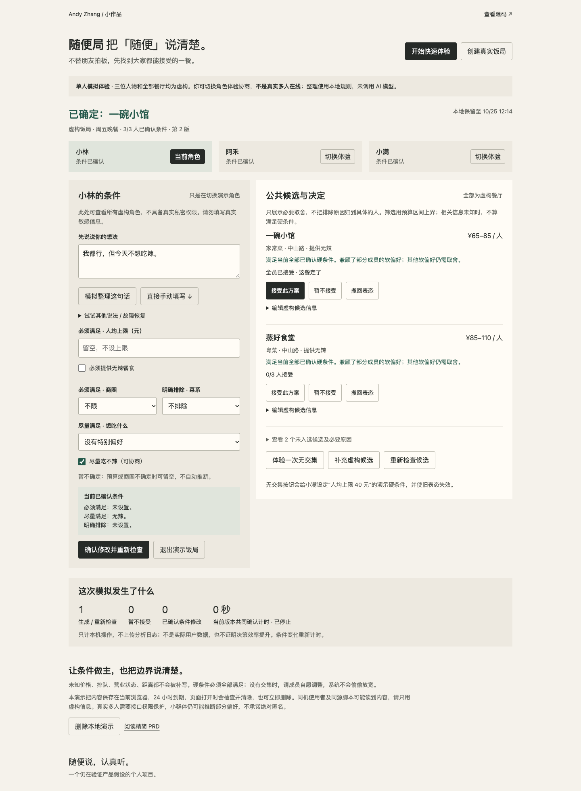
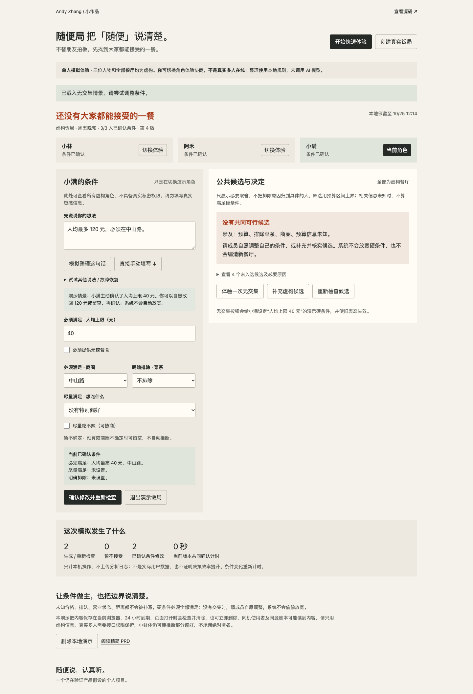
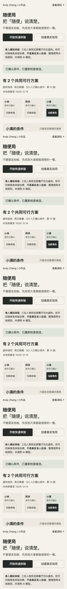

# 随便局

**把「随便」说清楚。** 一个帮助朋友表达聚餐条件、发现冲突、协商调整并共同确认的轻量生活 AI 产品原型。

[立即体验](https://andyzhang666666.github.io/suibianju/) · [精简 PRD](docs/PRD.md) · [实施与部署](docs/IMPLEMENTATION.md)

## 从哪一个生活问题出发
几个人约饭，每个人都说“随便”，提议出来后又不断被否决。我的产品假设是：困难可能来自没有被表达的限制，而不只是没有餐厅推荐。预算、不想跑远或明确忌口，容易被一句“随便”盖过去。这是待验证假设，没有调研、用户量或效率提升数据。

本项目独立于工作履历，重点是把这个判断落实成可体验、可修改、可验证的机制。

## 一分钟试一次
1. 打开快速体验，替小林点击“模拟整理这句话”，核对条件后确认。也可以跳过整理直接手填。
2. 看共同可行候选，接受一个方案；切换阿禾、小满，分别接受同一个方案，看到“已确定”。角色均为虚构，始终是你一人在操作。
3. 点击“体验一次无交集”，观察 40 元上限导致的冲突；自愿调整条件，或补充一个信息完整的虚构候选，再确认。

## 产品机制与实现边界
| 已实现 | 机制 |
| --- | --- |
| 条件表达与本人确认 | 原话和结构化表单并存；必须满足、尽量满足、明确排除、暂不确定分开；草稿不直接影响结果 |
| 硬条件筛选 | 比较预算区间上界，检查商圈、无辣和排除菜系；相关信息未知则不进入可行集 |
| 软偏好与解释 | 只对已满足硬条件的候选排序，最多展示三项；不使用匹配百分比或“公平分” |
| 冲突恢复 | 不悄悄放宽条件；支持成员自愿调整、编辑或补充虚构候选 |
| 共同确认 | 全部有效成员接受同一候选才确定；条件、候选、成员变化清除旧表态，重复操作幂等 |
| 本机恢复 | 原话和个人表单即时保存、刷新恢复、24 小时到期检查清除、立即删除；故障后保留草稿，支持手动继续 |

**模拟部分**：语义整理是本地有限模板规则，不调用模型，不是通用自然语言理解。未支持的表达会提示手动填写；“不想吃辣”先放软偏好，“别太高”询问上限，不擅自升级为硬条件。故障按钮模拟的是整理失败，不代表已测试真实模型服务。三位人物、所有餐厅和本地计数都是虚构/模拟。

**AI 与程序分工**：未来模型只产生可编辑草稿、关键澄清和解释，本人确认后才进入规则层；筛选与共识状态永远由程序控制。现在用模拟整理验证交互，不把规则输出伪装成真实 AI 调用。

**未实现**：真实多人房间、跨设备同步、私密接口权限、邀请链接、服务端 TTL 与删除、真实模型代理/限流/超时。公开“创建真实饭局”入口如实说明缺口，不生成假房间。当前只提供固定三人演示，规则层要求有效成员 3–5 人。没有实时商家数据、地图、预订、支付或向外发送消息。

## 运行与测试
无构建步骤、运行依赖、环境变量或密钥。克隆官网仓库后，在根目录运行：

```sh
python3 -m http.server 8794 --bind 127.0.0.1
# 打开 http://127.0.0.1:8794/suibianju/
node --test suibianju/tests/engine.test.mjs
```

浏览器测试是可选开发依赖：安装 `playwright` 并安装 Chrome 后运行 `node suibianju/tests/browser.cjs`。可用 `PLAYWRIGHT_MODULE` 指向已安装包，用 `CHROME_PATH` 指定浏览器，`BASE_URL` 指定测试站点，`NO_SCREENSHOTS=1` 禁止覆盖截图。该脚本会改动测试浏览器里的本地演示数据，不会发送外部请求或修改线上文件。

规则测试覆盖 21 项，包括硬条件组合、共同确认、变更失效、无交集、未知信息、重复点击、退出/加入、损坏/过期存储与模拟故障恢复。浏览器测试覆盖完整操作及 1440/768/390/360px 无横向溢出。详细结果和未适用项见 [验证记录](docs/VALIDATION.md)。这些是功能结果，不是产品效果或完整无障碍审计。

## 数据与公开 Demo 安全
- 无 API 密钥、无网络模型请求、无分析 SDK；页面 CSP 禁止 connect 请求，不加载外部字体。
- 演示内容只存当前浏览器 `suibianju-demo-v1`，同机用户及同源脚本可能访问；**没有真实隐私隔离，请只用虚构信息**。
- 公共区不展示原话或按人归因的限制；这只是展示机制。切换演示角色仍能读所有虚构内容，不可据此宣称“他人无法读取偏好”。
- 删除按钮立即清本地记录；24 小时过期在页面加载、恢复可见和运行中检查时清除。关闭的浏览器不会执行后台清理；重新打开才会检查，不声称后台定时删除。
- 本机事件计数不保存原话日志、不上传；原话仅作为本地演示状态保存。没有真实试用前不宣称提升效率、达成率或满意度。
- 真实多人上线前必须实现服务端权限、不可猜成员凭证、TTL/删除和越权读写测试；真实模型上线前必须配置服务端密钥、限流、超时、输出校验和手动恢复。小群体仍可能推断部分偏好，不承诺绝对匿名。

## 真实截图
以下由浏览器实际运行生成；不是设计稿，数字仅是本次单人模拟操作。



<details><summary>共同确认、无交集与手机体验</summary>





</details>

## 下一步验证
先在具备权限隔离的真实模式中招募少量自愿试用者；按 PRD 定义记录收集完成至共同确认的耗时、真实饭局达成率、推荐后否决/修改/重算、模型理解修正和硬条件违规，再回访是否采用及愿意复用。此处没有填入任何效果结果。
