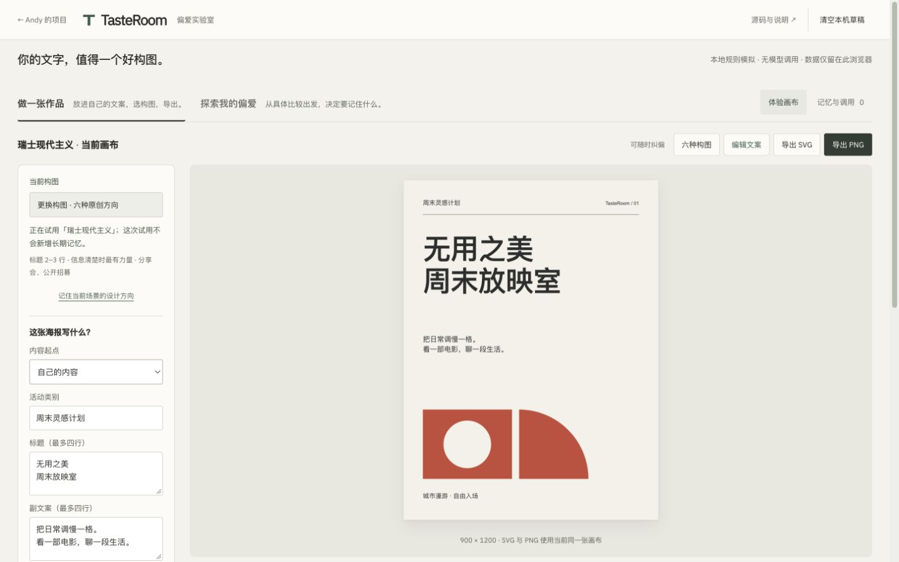

# TasteRoom · Preference Lab

Visual refresh approved after user review, 2026-11-02: [design, references and before/after screenshots](docs/VISUAL-CRAFT-20261102.md). Existing product behavior is preserved; the merge commit and Pages workflow record publication.


[中文](README.md) · [Live demo](https://andyzhang666666.github.io/tasteroom/) · [Swiss composition](https://andyzhang666666.github.io/tasteroom/?direction=swiss) · [Product scope](docs/PRD.md)

Liking a poster does not tell a system which feature you liked, or where that preference should apply. TasteRoom turns this into an editable interaction: compare, identify a clue, confirm its scope, then test it in another context.

Edit poster copy and export SVG or 900x1200 PNG without saving a preference. A/B choices remain temporary until a memory scope is explicitly confirmed.

<!-- github-evidence-20261031 -->



[Design decisions](docs/DESIGN.md) · [Validation records](docs/VALIDATION.md)

## Try it

The current product includes six independent compositions, two artwork candidates, any explicit A/B direction pair, and reusable preference briefs. JSON v1 and previous Markdown briefs are validated and previewed before merging rules; artwork exports never contain private feedback. [Implementation boundaries](docs/PRODUCT-DEPTH.md).

1. Choose among Swiss, deconstructed, editorial, Bauhaus, Japanese whitespace and two-ink compositions using the same copy. Keep up to two candidate artworks without saving preference rules.
2. Use a single-variable comparison for typography, spacing, colour or another dimension. Pick A, B or neither; a choice alone is not permission to save a rule.
3. Choose once, the current context or all contexts. Switch content and context to inspect the result, then revoke or edit the memory.
4. Export SVG or 900×1200 PNG from the same renderer. Export a style brief as Markdown or reusable JSON; import it with an explicit replacement preview before applying rules.

## Decisions in the interface

Inferred clues stay distinct from authorised rules. Explicit rules take precedence, and context-specific needs can differ from everyday preferences. Global corrections and conflicts are visible. Undo applies to the current interaction session; long-term memory changes have their own controls.

The workbench supports editable title, supporting copy and signature. Composition transitions and control feedback respect reduced-motion settings.

## Run locally

The public product uses local rules and original sample posters. No model or image-generation service is called.

```sh
python3 -m http.server 8870 --bind 127.0.0.1
```

Run from the website repository root and open `http://127.0.0.1:8870/tasteroom/`. No build step is required for this static mode.

Memory and context are stored only in the current browser; storage failures fall back to the current page session. The rule parser is deliberately limited and does not understand arbitrary language. A local optional model proxy exists, but a real provider was not configured, deployed or validated.

[Design decisions](docs/DESIGN.md) · [Second iteration](docs/V2.md) · [Validation records](docs/VALIDATION.md) · [Chinese implementation notes](README.md)

The project demonstrates interaction mechanisms, not measured preference accuracy, adoption or retention. Original poster content is fictional; font notices remain in `fonts/LICENSE.txt`.
