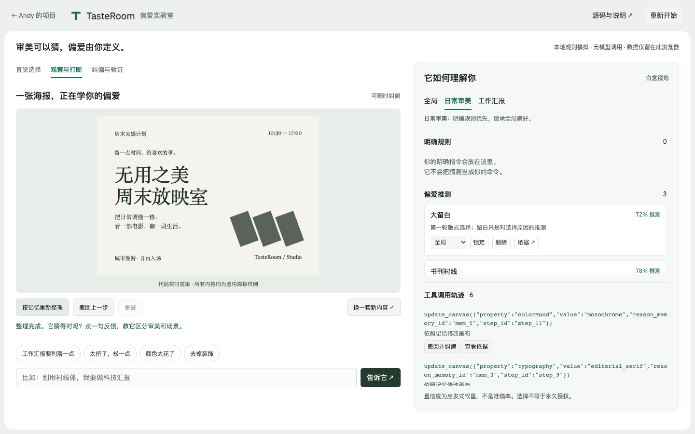
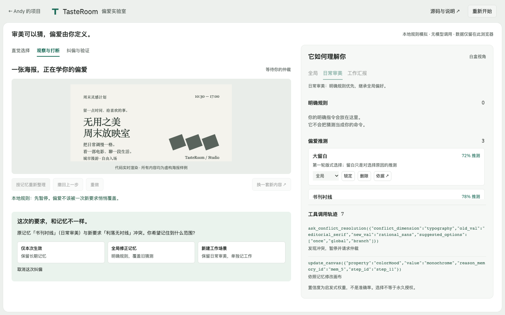

# TasteRoom · 偏爱实验室

**你喜欢的风格，不一定适合每个场景。** TasteRoom 是一个可实际体验的生活审美 Agent Demo：从两次直觉选择开始，让系统猜你的偏爱，再通过打断和纠偏，决定哪些偏爱值得记住、应该记在哪个场景。

[立即体验](https://andyzhang666666.github.io/tasteroom/) · [精简 PRD](docs/PRD.md) · [设计与环境核对](docs/DESIGN.md) · [部署说明](docs/DEPLOYMENT.md) · [验证记录](docs/VALIDATION.md)

这是个人独立项目，与工作经历无关。公开版使用**本地规则模拟**，没有真实模型调用；海报全部由 HTML/CSS 渲染，不调用生图服务。30–45 秒是体验设计目标，尚未开展真人计时研究。

## 先玩一遍

1. 第一轮选「留白书刊」，第二轮选喜欢的配色。
2. 观察画布逐步变化，以及每次 `update_canvas` 引用的记忆依据。
3. 点击「工作汇报要利落一点」，选择「新建工作场景」。
4. 在「日常审美／工作汇报」之间切换，再「换一套新内容」，观察字体和记忆的区别。

也可以尝试「仅本次生效」「全局修正记忆」，撤回任意操作，或在右侧删除、锁定、迁移记忆。手机使用「体验画布／记忆与调用」切换。





## 生活场景与产品判断

“我喜欢这张”往往说不清是因为留白、字体还是配色。把一次点击直接存成长期指令，会让推荐越走越偏；而日常喜欢的书刊感，也可能不适合工作汇报。

因此，点击只生成可推翻的推测；明确表达才成为规则。新要求与高置信推测或明确规则冲突时，系统先问适用范围，再改变记忆。可解释性体现在实际修改、记忆来源和可撤回操作中。

## 程序与 AI 的分工

| 部分 | 已实现行为 |
| --- | --- |
| 画布与工具 | 五个枚举属性驱动 CSS；每步修改绑定 memory id，轨迹记录实际调用 |
| 记忆 | implicit / explicit，置信度、场景、来源及覆盖状态；明确优先、同级场景优先 |
| 确定性控制 | 冲突检测、暂停与取消异步任务、仲裁、逐步撤回与重做、状态校验 |
| 公开版解析 | 本地关键词规则将可识别文本映射为结构化反馈；未知表达提示未理解 |
| 可选模型解析 | 服务端 Chat Completions 兼容适配器返回 dimension/value，再经枚举校验，由同一个状态机执行工具和记忆变更 |

程序没有把规则匹配包装成模型推理，也没有多人或跨设备协作。推测权重 72%／78%／76% 是人为设定的启发式值，**不是准确率或经校准的模型概率**。第一轮卡片混合字体与留白，刻意保留不确定性，供用户纠偏；目前没有在线学习或统计训练。

五个受控维度为 `layoutDensity`、`typography`、`alignment`、`colorMood`、`decorElements`。工具实现见 [engine.js](engine.js)，包括 `update_canvas`、`rollback_canvas`、`upsert_memory`、`ask_conflict_resolution`。Redo 和直接记忆管理也有独立日志；冲突仲裁以枚举值执行，不执行模型输出代码。

## 本地运行

Node.js 22 或更新版本。应用运行本身无第三方依赖：

```sh
cd tasteroom
node server.mjs
# 打开 http://127.0.0.1:8798/
```

也可用任意静态服务器运行仓库根目录并访问 `/tasteroom/`。不能直接双击 HTML，浏览器需要通过 HTTP 加载 ES modules。

```sh
node --test tests/*.test.mjs
```

可选浏览器测试需要 Playwright：

```sh
npm install
npx playwright install chromium
node server.mjs
# 另开终端，在 tasteroom 中运行
npm run test:browser
```

使用系统 Chrome 可设置 `CHROME_CHANNEL=chrome`；`TEST_URL` 指定待验证地址，`EVIDENCE_DIR` 指定截图目录。无设置时浏览器测试使用 `http://127.0.0.1:8798/` 并把证据写到 `docs/media/`。

## 可选真实模型模式

GitHub Pages 公开版不支持服务端执行，默认 `mode.json` 固定为 mock。无需填写 Key 就能体验全部状态机。可选服务端适配器只在本机启动，不会自动开通服务或产生调用。

如自行启用，先在服务端环境中设置 `LLM_API_KEY`；可设置 `LLM_MODEL`，默认 `gpt-4.1-mini`，实际可用性取决于服务商与账号。`LLM_URL` 默认 OpenAI Chat Completions 地址，也可配置兼容服务的完整端点。接口格式依据 [官方 Chat Completions 文档](https://developers.openai.com/api/reference/python/resources/chat/subresources/completions/methods/create)。没有做模型效果评测或真实账号连通性测试，不保证任意兼容服务支持 JSON mode。

- 不在浏览器中填写、存储、发送 Key；服务端使用 Authorization header 调用上游。
- 同源检查、400 字文本限制、4KB 请求上限、单 IP 每分钟 10 次、4.5 秒上游超时和枚举校验。
- 模型错误、限流或浏览器 5.5 秒超时后回到本地解析，界面提示降级。未知表达不写入记忆。
- 本机服务不等于公开模型网关。如将来公网开放，应先补访问控制、可信代理 IP 处理、跨实例限流与成本配额，再部署，当前无此服务。

## 记忆与撤回的边界

明确规则优先于推测；同级别中当前场景优先于全局。全局修正会覆盖同维度所有活跃场景规则，旧条目标记 overridden 并保留在存储中；面板只显示当前场景和全局的 active 规则。

「仅本次」不会进入持久记忆，换内容、切场景或刷新后结束。新建工作场景时保留日常规则。删除、锁定和迁移规则会重新生成当前画布；切场景或重新生成会开启新的操作栈。撤回画布步骤不会暗中删除长期记忆，重做恢复原操作；新反馈、记忆管理与重置会取消等待中的整理操作。

localStorage 仅保存当前浏览器的记忆和场景；逐步轨迹与操作栈在内存中，刷新后重新生成。浏览器禁用存储时降级到内存并提示；可「重新开始」清空本项目状态。自由输入可能包含个人信息，请只输入审美反馈；公开版不上传输入。

## 已知限制与后续

已实现：完整本地交互闭环、记忆编辑、场景仲裁、可追溯工具调用、撤回／重做、移动布局、基础自动化测试。可选模型代理通过本机假服务测试，**真实模型未配置、未部署、未验证**。

规则引擎不支持任意自然语言、多维同时解析或复杂否定，不会理解所有表达；可使用快捷反馈。海报是固定样例和参数组合，不是通用设计工具。只做 Chrome 自动化与三个响应宽度检查，未宣称跨浏览器、完整 WCAG、Lighthouse 或真实用户验证。后续优先验证用户能否理解记忆范围，再决定是否增加模型能力。

字体 IBM Plex Sans 随项目托管，来源 Google Fonts / IBM，许可证见 [fonts/LICENSE.txt](fonts/LICENSE.txt)。海报文字与图形为本项目原创虚构示例，无外部照片或视频素材。
